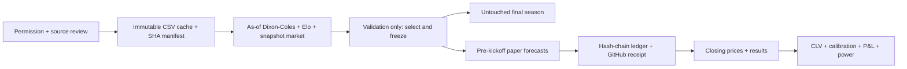

# closing-line-lab

**Paper-only research.** No bookmaker account, bet placement or money handling.

<!-- RESULTS:START -->
**0 research dataset rows; 0 forward forecasts; 0 paper bets; 0 settled bets.**
Data status: **BLOCKED_DATA_PERMISSION**. Validation: **NOT_RUN**. Test season: **UNEVALUATED**.

| Forward metric | Observed value |
|---|---:|
| Mean log CLV | NOT_ESTIMABLE |
| 95% date-block bootstrap CI | NOT_ESTIMABLE |
| Paper profit (initial account 100 units) | 0.0 |
| Pending / void forecasts | 0 / 0 |

Source: [status](results/status.json), [forward results](results/forward.json).


<!-- RESULTS:END -->

The research question is whether a pre-registered football model can obtain positive mean
log closing-line value (CLV) on prices recorded before kickoff. Dixon–Coles, Elo and a
market-anchored logistic blend are compared chronologically. There is no asserted edge.
More matches do not imply independent observations; inference clusters by calendar date.



The source now restricts automated data-training products and is **not open-licensed**.
See [DATA_NOTICE.md](DATA_NOTICE.md). Permission is unresolved; no bulk data has been
downloaded, and scheduled jobs must report the gate honestly. Source pre-closing quotes
are not true opening quotes. Pinnacle data is excluded following the provider's stale-feed
warning. All plots and metrics will distinguish historical proxies from forward observations.

Python 3.12 and uv: `make install`, `make check test`, `make verify`.
The implementation includes Dixon–Coles with exponential time decay, Elo, and a regularized
multinomial logistic blend anchored to market probabilities. Results are **not yet measured**.

## Reproduce

See the [runbook](docs/RUNBOOK.md), [draft protocol](PREREGISTRATION.md) and
[iteration targets](ITERATIONS.md). After source permission is established:

```sh
make download                 # content-addressed cache and source audit
make features                 # training/validation only
make backtest                 # declared candidates; no test-season selection
make select                   # validation log loss chooses the model
# Commit the reviewed protocol/selection and create forward-v1 before opening the test.
uv run cll features --stage test
uv run cll backtest --stage test
gh workflow run paper.yml --ref main
make verify
make report
```

Until selection is measured and committed, `forward-v1` is intentionally absent. It would
be misleading to call an unvalidated, unselected runtime a frozen research result.

Scheduled Actions run four times daily. The forecast job publishes before kickoff and
dispatches an independent ledger audit; the scoring job appends outcomes and closing
prices. Source permission is checked first. A green gated run proves the schedule or
workflow dispatch worked; it does **not** prove live data or paper forecasts work.

## Provenance

| Number / claim | Result file | Command | Commit |
|---|---|---|---|
| Observed research counts / blocked status | `results/status.json` | `uv run cll report` | Use `git log -1 --format=%H -- results/status.json` |
| Source restrictions and schema | `DATA_NOTICE.md` | Source documentation review, 2026-10-29 | Use `git log -1 --format=%H -- DATA_NOTICE.md` |
| Local test results and source revision | `results/engineering.json` | `make check test` | `source_commit` in the result file |
| GitHub CI, audit and scheduled-run evidence | `results/actions_evidence.json` | `uv run cll actions-evidence` | Each run's `headSha` and server URL |
| Future validation/test estimates | `results/validation.json`, `results/test.json` (absent until run) | `cll backtest --stage validation/test` | `source_commit` in each result |
| Forward CLV, paper profit and power | `results/forward.json` | `uv run cll report` | `source_commit` in the result file |

## Limits and interpretation

- No real-data fit, held-out score, economic edge or live timing claim is established yet.
  Empty plots show missing observations; they are not a zero-return experiment.
- Two schema-previewed test fixtures are prospectively excluded from primary held-out
  metrics. No fitting or model selection used them; the full season is not fully blinded.
  Exact identifiers and the exception are recorded in `docs/source_review.json`.
- CSV prices are periodically captured snapshots. Historical decision times and result
  availability are proxies. Forward snapshots also do not prove an executable bookmaker
  price. No exchange commission, liquidity, account limits or slippage is modeled.
- Raw CLV across B365 and AvgC can reflect different margins. De-vigged CLV and same-book
  closing CLV are secondary checks. Positive CLV alone cannot establish profitable execution.
- Date clustering reduces effective sample size. Bootstrap intervals, power calculations,
  DSR and calibration remain estimates with assumptions; no number of matches guarantees
  an edge. Lower-division/draw splits are descriptive, not another selection opportunity.
- GitHub receipts bound when ledger content existed on GitHub. Hash chaining exposes edits
  against retained history; an owner can still delete history or workflows. Private evidence
  requires reviewer access. Retain external receipts and clones; do not call this immutable.
- Hosted schedules can be delayed. Deadline checks reject late batches, and later verification
  fails any forecast lacking an on-time server receipt. No forecast is backfilled or backdated.

## Prior art

[Dixon & Coles (1997)](https://doi.org/10.1111/1467-9876.00065) motivates score modeling;
[Kaunitz, Zhong & Kreiner (2017)](https://arxiv.org/abs/1710.02824) studies market-based
football pricing; [Buchdahl's closing-line discussion](https://football-data.co.uk/blog/closing_odds.php)
motivates the benchmark. [Bailey & López de Prado (2014)](https://www.davidhbailey.com/dhbpapers/deflated-sharpe.pdf)
motivates the secondary multiple-trial Sharpe correction. None establishes that this model
has an edge. Bibliographic and licence details are in the third-party notices.

Copyright Nicolas Coquelet. Code: [MIT](LICENSE). Data and dependencies:
[THIRD_PARTY_NOTICES.md](THIRD_PARTY_NOTICES.md).
