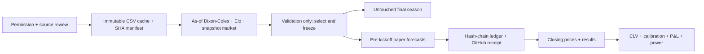

# closing-line-lab

**Paper-only research.** No bookmaker account, bet placement or money handling.

<!-- RESULTS:START -->
**0 downloaded match rows; 0 forward forecasts; 0 paper bets; 0 settled bets.**
Data status: **BLOCKED_DATA_PERMISSION**. Validation: **NOT_RUN**. Test season: **UNOPENED**.

| Forward metric | Observed value |
|---|---:|
| Mean log CLV | NOT_ESTIMABLE |
| 95% date-block bootstrap CI | NOT_ESTIMABLE |
| Paper profit (initial account 100 units) | 0.0 |
| Pending / void forecasts | 0 / 0 |

Source: [status](results/status.json), [forward results](results/forward.json).

<!-- RESULTS:END -->

The research question is whether a pre-registered football model can obtain positive mean
log closing-line value (CLV) on prices recorded before kickoff. Dixon–Coles, Elo and a
market-anchored logistic blend are compared chronologically. There is no asserted edge.
More matches do not imply independent observations; inference clusters by calendar date.

The source now restricts automated data-training products and is **not open-licensed**.
See [DATA_NOTICE.md](DATA_NOTICE.md). Permission is unresolved; no bulk data has been
downloaded, and scheduled jobs must report the gate honestly. Source pre-closing quotes
are not true opening quotes. Pinnacle data is excluded following the provider's stale-feed
warning. All plots and metrics will distinguish historical proxies from forward observations.

Python 3.12 and uv: `make install`, `make check test`, `make verify`.
Research commands and the pre-registration are documented as the pipeline is implemented.

## Provenance

| Number / claim | Result file | Command | Commit |
|---|---|---|---|
| Observed research counts / blocked status | `results/status.json` | `uv run cll report` | Use `git log -1 --format=%H -- results/status.json` |
| Source restrictions and schema | `DATA_NOTICE.md` | Source documentation review, 2026-10-29 | Use `git log -1 --format=%H -- DATA_NOTICE.md` |

Copyright Nicolas Coquelet. Code: [MIT](LICENSE). Data and dependencies:
[THIRD_PARTY_NOTICES.md](THIRD_PARTY_NOTICES.md).
