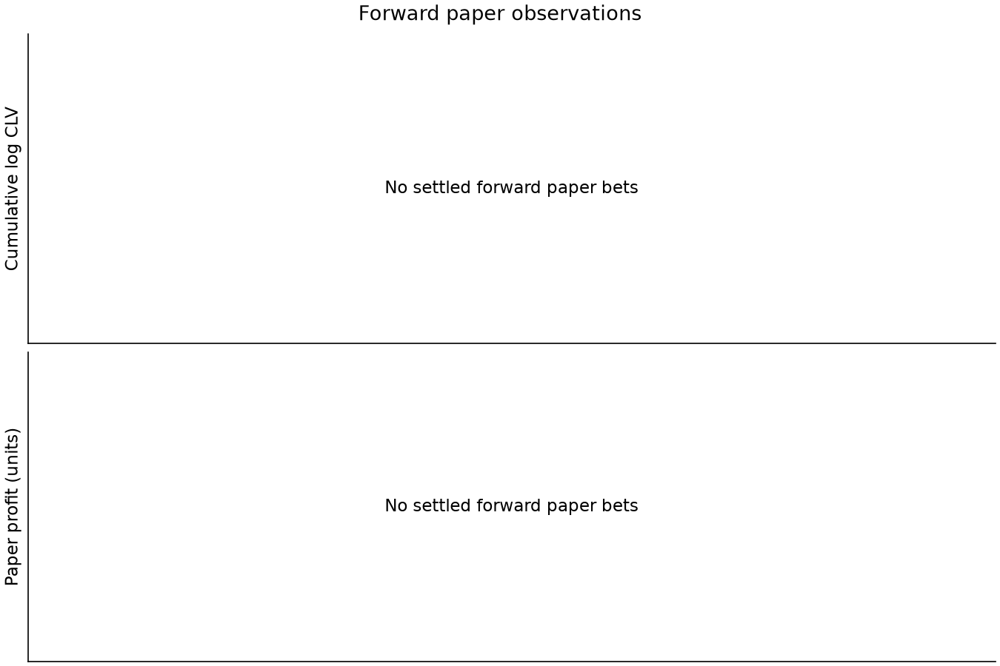
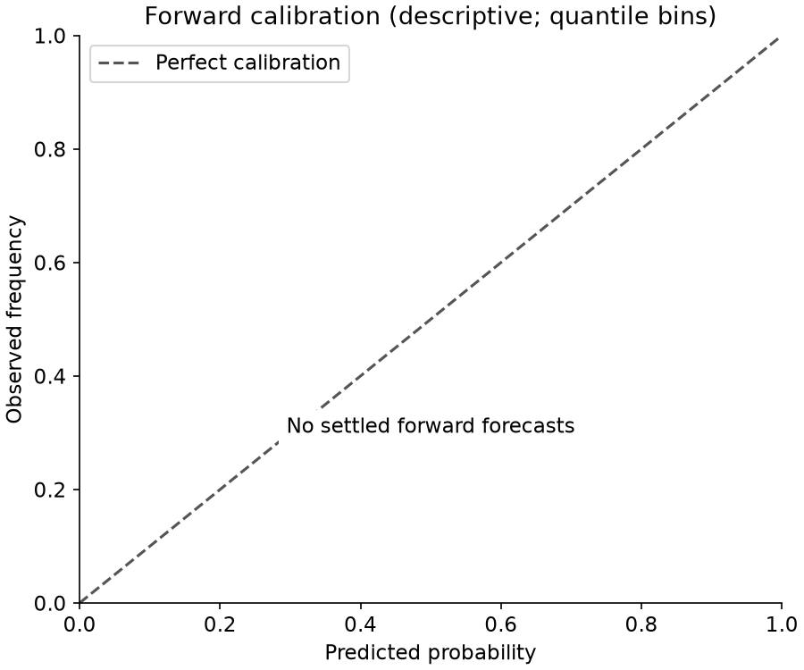
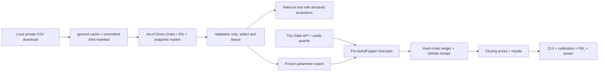
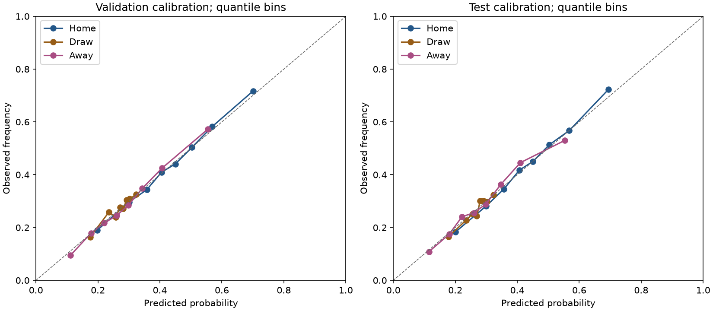
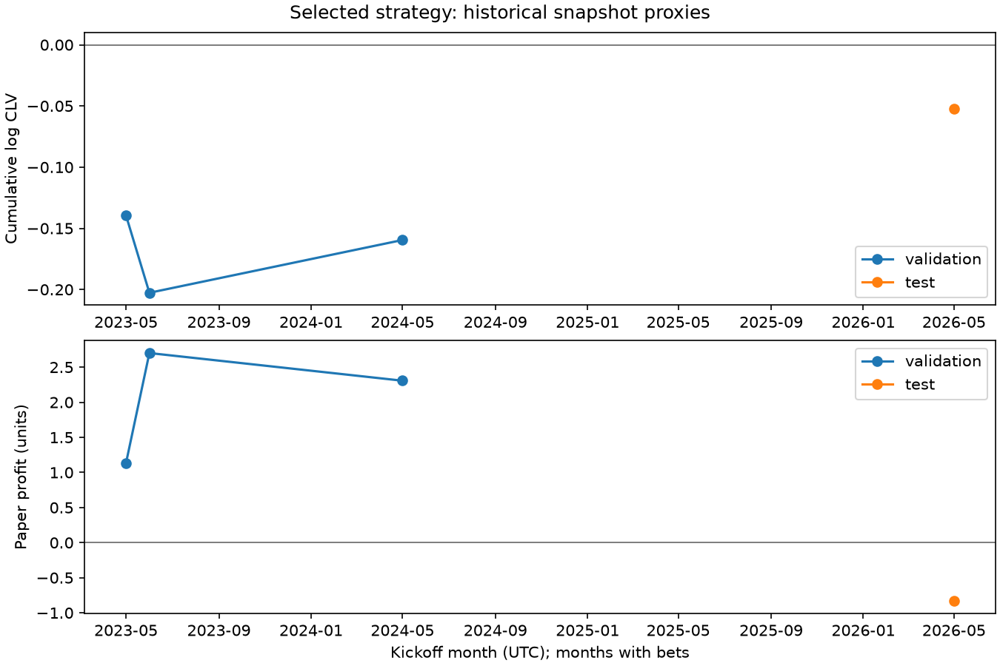

# closing-line-lab

**Paper-only research.** No bookmaker account, bet placement or money handling.

<!-- RESULTS:START -->
**55476 research dataset rows; 0 forward forecasts; 0 paper bets; 0 settled bets.**
Data status: **PREPARING_MODEL**. Validation: **COMPLETE**. Test season: **EVALUATED_ONCE**.

| Forward metric | Observed value |
|---|---:|
| Mean log CLV | NOT_ESTIMABLE |
| Descriptive date-bootstrap quantiles | NOT_ESTIMABLE |
| CLV inference (disabled for this pilot) | INSUFFICIENT_INFORMATION |
| Paper profit (initial account 100 units) | 0.0 |
| Pending / void forecasts | 0 / 0 |

Validation selected **blend / 0.05 minimum edge**: 11486 scored matches, log loss 1.0057639497705855 versus closing 1.002834479064554 (gap 0.002929470706031445).
Only 4 paper bets; mean log CLV -0.0398891288028935, descriptive date-bootstrap quantiles [-0.08678290542845579, 0.016520650702510617]. These are not calibrated confidence limits. the selected rule's sparse bets severely limit forward power.

| Validation model | Minimum edge | Log loss | Paper bets | Mean log CLV |
|---|---:|---:|---:|---:|
| market | 0.03 | 1.0063675492486361 | 0 | None |
| market | 0.05 | 1.0063675492486361 | 0 | None |
| dc | 0.03 | 1.0259169666789891 | 3401 | -0.0043107974661079 |
| dc | 0.05 | 1.0259169666789891 | 3192 | -0.004204388069203356 |
| elo | 0.03 | 1.0259362847864204 | 3465 | -0.007974626992547858 |
| elo | 0.05 | 1.0259362847864204 | 3272 | -0.007093607128997683 |
| blend | 0.03 | 1.0057639497705855 | 14 | -0.04823819541359959 |
| blend | 0.05 | 1.0057639497705855 | 4 | -0.0398891288028935 |

Held-out test: 3754 scored matches; log-loss gap to closing 0.0010033873760322276; 2 paper bets; mean log CLV -0.02607313191949432, descriptive bootstrap quantiles [-0.15984870094189613, 0.10770243710290749]. Paper P&L -0.8326864888550614 units; ROI -1.0.
Test DSR: NOT_ESTIMABLE (2 nonzero return days). Power planning (one-sided 5%, 80%): NOT_ESTIMABLE bets by log-CLV basis-point effect; sparse-sample estimates are unstable.

Sources: [status](results/status.json), [validation](results/validation.json), [original test](results/test.json), [corrected replay](results/review_corrections.json), [forward](results/forward.json).


<!-- RESULTS:END -->

The research question is whether a pre-registered football model can obtain positive mean
log closing-line value (CLV) on prices recorded before kickoff. Dixon–Coles, Elo and a
market-anchored logistic blend are compared chronologically. There is no asserted edge.
More matches do not imply independent observations. This pilot has no validated CLV
significance rule; calendar-date bootstrap endpoints are descriptive.



Historical football-data rows are downloaded once for the owner's private research and
stay local. Only code, SHA manifests, fitted parameters and aggregate results are committed.
Hosted forward collection uses The Odds API, whose terms permit programmatic research.
See [DATA_NOTICE.md](DATA_NOTICE.md). Historical non-C prices are pre-closing snapshots,
not verified opening quotes; the provider's stale Pinnacle fields are excluded.

Python 3.12 and uv: `make install`, `make check test`, `make verify`.
The implementation includes Dixon–Coles with exponential time decay, Elo, and a regularized
multinomial logistic blend anchored to market probabilities. All eight declared validation
candidates and the frozen held-out result are reported above.

## Reproduce

See the [runbook](docs/RUNBOOK.md), [registered protocol](PREREGISTRATION.md) and
[iteration targets](ITERATIONS.md). Historical authoring (download → features → candidates → selection → original tag →
once-only test → parameter export) is complete. Normal clones must not repeat selection
or replace registered reports. With the matching private cache and local research permission:

```sh
uv sync --frozen
make check test
OPENBLAS_NUM_THREADS=1 OMP_NUM_THREADS=1 uv run cll replay \
  --output-dir runs/reviewer-replay --rebuild-features
# Compare runs/reviewer-replay/replay.json with results/review_corrections.json.
make verify
```

Replay regenerates monthly DC/as-of Elo features, all declared validation predictions and
the fixed selected test rule in an isolated directory. It does not reselect a model, mutate
tags or overwrite registered artifacts. Row-level outputs remain ignored. Exact source-data
replay requires the private cache matching the committed manifest; mutable URLs cannot
recover a lost historical snapshot. `make select` is for the original pre-freeze authoring
sequence only and intentionally refuses reselection. Validation and test commands now both
refuse to overwrite registered result files.

The original `forward-v1`, `forward-v1.1` and `forward-v1.2` tags are retained. The
prospective **forward-v1.3** amendment repairs evidence/budget/settlement handling and
withdraws the uncalibrated CLV significance rule before any forward observation. No fitted
coefficient, forecast formula, selected threshold or staking parameter changed.
[Corrected replay](results/review_corrections.json) preserves the original point estimates;
[original test](results/test.json) remains historical evidence. Both synthetic-only inference
candidates failed the predeclared calibration screen; this pilot reports **descriptive CLV,
with no confirmatory rejection rule**. Sparse bootstrap endpoints are quantiles, not calibrated
confidence limits. See the explicit amendment and failed experiments in the protocol.




[Power analysis](results/power_analysis.json): the four validation bets give an unstable
planning estimate of 23,821 bets for 10 log-CLV bp (one-sided 5%, 80% power). Two test bets
cannot estimate power. The planned window is unlikely to establish a small edge for this
sparse rule. The hypothesis remains prospective; insufficient evidence will be reported.

The workflow is configured hourly at minute 17 UTC for EPL and Championship; genuine
scheduled execution has not yet been observed. A separate scoring job starts when results
are due. Actual forecast, close and settlement receipts are separate pending acceptance checks. Free fixture
discovery triggers league-wide EU/h2h requests only around decisions (23–25 hours before
kickoff) or closing snapshots (15–75 minutes). **The closing line means the last observed
pre-kickoff snapshot**, with bookmaker, source age and actual gap retained. Betfair EU is
preferred; Pinnacle is the fixed fallback. A 400-credit cap and 100-credit provider reserve
protect the 500-credit plan. Each paid transmission first commits a reservation to the
separate `api-budget` branch. An ambiguous request blocks further paid calls until manual
reconciliation; a failed runner cannot erase reservations. Paid requests are not retried. [API costs](https://the-odds-api.com/liveapi/guides/v4/) define this budget. Missing windows/budget-limited coverage are never backfilled.
Recent results cost two credits per league; at most one request per league/day when needed.
Forward parameters are exported locally after freezing and stay fixed for v1. No hosted
football-data download, historical row cache or retraining occurs. See the protocol for
source shifts, model drift, commission and the Actions-minute planning assumptions. The
[GitHub Free allowance](https://docs.github.com/en/billing/concepts/product-billing/github-actions)
is shared across the owner’s private repositories; it is not a separate allowance per repo.

## Provenance

| Number / claim | Result file | Command | Commit |
|---|---|---|---|
| Historical row count / coverage | [data_quality.json](results/data_quality.json), [manifest](data/manifest.jsonl) | `cll download` (local only) | `c297fa0`; processed SHA in result |
| All eight validation candidates | [validation.json](results/validation.json) | `cll features`; `cll backtest --stage validation` | `source_commit` = `c297fa0` |
| Original held-out scores, CLV quantiles, P&L, DSR arithmetic | [test.json](results/test.json) | `cll features --stage test`; `cll backtest --stage test` | `source_commit` = `7c16ca0`; original `forward-v1` |
| Calibration bins, paths, paired loss quantiles | [historical_analysis.json](results/historical_analysis.json) | `cll research-report` (local saved predictions) | `source_commit` in result |
| Corrected missingness, pending stakes, DSR guard, replay agreement | [review_corrections.json](results/review_corrections.json) | `cll replay --output-dir runs/full_replay --rebuild-features` | `source_commit` and implementation hashes in result |
| Failed inference candidates | [candidate 1](results/null_calibration_candidate1.json), [candidate 2](results/null_calibration.json) | `python scripts/calibrate_inference.py` (see ITERATIONS for flags) | Source and implementation hashes in results |
| Planning power / insufficiency | [power_analysis.json](results/power_analysis.json) | Extract selected `power` from validation/test reports | Same source commits as reports above |
| Exact forward parameters / identity coverage | [fitted_model.json](config/fitted_model.json), [activation](results/forward_activation.json) | `cll prepare-forward`; exact identity check | `source_commit` and artifact SHA; frozen in `forward-v1.1` and `forward-v1.2` |
| API availability / credits | [api_smoke.json](results/api_smoke.json), [usage](data/api_usage.json) | Client `/events` and `/odds` smoke checks | `c297fa0`; response hashes in API manifest |
| Forward counts, CLV, P&L, gap/benchmark mix | [forward.json](results/forward.json) | `cll report` | `source_commit` in each result; ledger links runtime/registration SHAs |
| Backtest vs forward | [comparison.json](results/comparison.json) | `cll report` | `source_commit` in result |
| CI, audits, genuine schedule events | [actions_evidence.json](results/actions_evidence.json), [schedule check](results/schedule_check.json) | `cll actions-evidence`; `make verify` | Each run's `headSha`, server time and URL |
| Required tests / code checks | [engineering.json](results/engineering.json) | `make check test` | Source revision and environment in result |

## Limits and interpretation

- The held-out point estimates do not beat the closing line. Two selected bets and two
  dates do not support calibrated CLV inference. The original percentile endpoints are
  descriptive only; neither synthetic HAC candidate passed the calibration screen. The near-market blend
  usually abstains; thousands of forecasts do not become thousands of independent bets.
  Empty forward plots show missing observations, not a zero-return experiment.
- Two schema-previewed test fixtures are prospectively excluded from primary held-out
  metrics. No fitting or model selection used them; the full season is not fully blinded.
  Exact identifiers and the exception are recorded in `docs/source_review.json`.
- CSV prices are periodically captured snapshots. Historical decision times and result
  availability are proxies. Forward snapshots also do not prove an executable bookmaker
  price. Forward exchange paper P&L deducts 2% of winnings; liquidity, limits and slippage are unmodeled.
- Raw CLV across B365 and AvgC can reflect different margins. De-vigged CLV and same-book
  closing CLV are secondary checks. Positive CLV alone cannot establish profitable execution.
- Date clustering reduces effective sample size. Bootstrap quantiles and power calculations
  remain descriptive with assumptions. DSR is NOT_ESTIMABLE below 30 nonzero return days
  and 60 calendar days; its old arithmetic is retained only in source artifacts; no number of matches guarantees
  an edge. Lower-division/draw splits are descriptive, not another selection opportunity.
- GitHub receipts bound when ledger content existed on GitHub. Hash chaining exposes edits
  against retained history; an owner can still delete history or workflows. Private evidence
  requires reviewer access. Retain external receipts and clones; do not call this immutable.
- Hosted schedules can be delayed. Deadline checks reject late batches, and later verification
  fails any forecast lacking an on-time server receipt. No forecast is backfilled or backdated.

## Prior art

[Dixon & Coles (1997)](https://doi.org/10.1111/1467-9876.00065) motivates score modeling;
[Kaunitz, Zhong & Kreiner (2017)](https://arxiv.org/abs/1710.02824) studies market-based
football pricing; [Buchdahl's closing-line discussion](https://football-data.co.uk/blog/closing_odds.php)
motivates the benchmark. [Bailey & López de Prado (2014)](https://www.davidhbailey.com/dhbpapers/deflated-sharpe.pdf)
motivates the secondary multiple-trial Sharpe correction. None establishes that this model
has an edge. Bibliographic and licence details are in the third-party notices.

Copyright Nicolas Coquelet. Code: [MIT](LICENSE). Data and dependencies:
[THIRD_PARTY_NOTICES.md](THIRD_PARTY_NOTICES.md).
