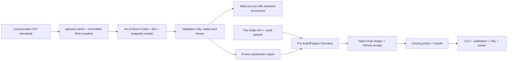

# closing-line-lab

**Paper-only research.** No bookmaker account, bet placement or money handling.

<!-- RESULTS:START -->
**55476 research dataset rows; 0 forward forecasts; 0 paper bets; 0 settled bets.**
Data status: **PREPARING_MODEL**. Validation: **COMPLETE**. Test season: **UNEVALUATED**.

| Forward metric | Observed value |
|---|---:|
| Mean log CLV | NOT_ESTIMABLE |
| 95% date-block bootstrap CI | NOT_ESTIMABLE |
| Paper profit (initial account 100 units) | 0.0 |
| Pending / void forecasts | 0 / 0 |

Validation selected **blend / 0.05 minimum edge**: 11486 scored matches, log loss 1.0057639497705855 versus closing 1.002834479064554 (gap 0.002929470706031445).
Only 4 paper bets; mean log CLV -0.0398891288028935, 95% date-block CI [-0.08678290542845579, 0.016520650702510617]. This does not establish an edge; the selected rule's sparse bets severely limit forward power.

| Validation model | Minimum edge | Log loss | Paper bets | Mean log CLV |
|---|---:|---:|---:|---:|
| market | 0.03 | 1.0063675492486361 | 0 | None |
| market | 0.05 | 1.0063675492486361 | 0 | None |
| dc | 0.03 | 1.0259169666789891 | 3401 | -0.0043107974661079 |
| dc | 0.05 | 1.0259169666789891 | 3192 | -0.004204388069203356 |
| elo | 0.03 | 1.0259362847864204 | 3465 | -0.007974626992547858 |
| elo | 0.05 | 1.0259362847864204 | 3272 | -0.007093607128997683 |
| blend | 0.03 | 1.0057639497705855 | 14 | -0.04823819541359959 |
| blend | 0.05 | 1.0057639497705855 | 4 | -0.0398891288028935 |

Sources: [status](results/status.json), [validation](results/validation.json), [test](results/test.json), [forward](results/forward.json).


<!-- RESULTS:END -->

The research question is whether a pre-registered football model can obtain positive mean
log closing-line value (CLV) on prices recorded before kickoff. Dixon–Coles, Elo and a
market-anchored logistic blend are compared chronologically. There is no asserted edge.
More matches do not imply independent observations; inference clusters by calendar date.



Historical football-data rows are downloaded once for the owner's private research and
stay local. Only code, SHA manifests, fitted parameters and aggregate results are committed.
Hosted forward collection uses The Odds API, whose terms permit programmatic research.
See [DATA_NOTICE.md](DATA_NOTICE.md). Historical non-C prices are pre-closing snapshots,
not verified opening quotes; the provider's stale Pinnacle fields are excluded.

Python 3.12 and uv: `make install`, `make check test`, `make verify`.
The implementation includes Dixon–Coles with exponential time decay, Elo, and a regularized
multinomial logistic blend anchored to market probabilities. Validation feature generation has completed; candidate metrics are pending.

## Reproduce

See the [runbook](docs/RUNBOOK.md), [draft protocol](PREREGISTRATION.md) and
[iteration targets](ITERATIONS.md). The owner has authorized the local research split:

```sh
make download                 # content-addressed cache and source audit
make features                 # training/validation only
make backtest                 # declared candidates; no test-season selection
make select                   # validation log loss chooses the model
# Commit the reviewed protocol/selection and create forward-v1 before opening the test.
uv run cll features --stage test
uv run cll backtest --stage test
gh workflow run paper.yml --ref main
make verify
make report
```

Until selection is measured and committed, `forward-v1` is intentionally absent. It would
be misleading to call an unvalidated, unselected runtime a frozen research result.

Scheduled Actions run hourly at minute 17 UTC for EPL and Championship. Free fixture
discovery triggers league-wide EU/h2h requests only around decisions (23–25 hours before
kickoff) or closing snapshots (15–75 minutes). **The closing line means the last observed
pre-kickoff snapshot**, with bookmaker, source age and actual gap retained. Betfair EU is
preferred; Pinnacle is the fixed fallback. A 400-credit cap and 100-credit provider reserve
protect the 500-credit plan. Missing windows/budget-limited coverage are never backfilled.
Recent results cost two credits per league; at most one request per league/day when needed.
Forward parameters are exported locally after freezing and stay fixed for v1. No hosted
football-data download, historical row cache or retraining occurs. See the protocol for
source shifts, model drift, commission and the Actions-minute planning assumptions.

## Provenance

| Number / claim | Result file | Command | Commit |
|---|---|---|---|
| Observed research counts / blocked status | `results/status.json` | `uv run cll report` | Use `git log -1 --format=%H -- results/status.json` |
| Source restrictions and schema | `DATA_NOTICE.md` | Source documentation review, 2026-10-29 | Use `git log -1 --format=%H -- DATA_NOTICE.md` |
| Local test results and source revision | `results/engineering.json` | `make check test` | `source_commit` in the result file |
| GitHub CI, audit and scheduled-run evidence | `results/actions_evidence.json` | `uv run cll actions-evidence` | Each run's `headSha` and server URL |
| Future validation/test estimates | `results/validation.json`, `results/test.json` (absent until run) | `cll backtest --stage validation/test` | `source_commit` in each result |
| Backtest vs forward availability | `results/comparison.json` | `uv run cll report` | `source_commit` in the result file |
| Forward CLV, paper profit and power | `results/forward.json` | `uv run cll report` | `source_commit` in the result file |

## Limits and interpretation

- No held-out score, economic edge or live forecast timing claim is established yet.
  Empty plots show missing observations; they are not a zero-return experiment.
- Two schema-previewed test fixtures are prospectively excluded from primary held-out
  metrics. No fitting or model selection used them; the full season is not fully blinded.
  Exact identifiers and the exception are recorded in `docs/source_review.json`.
- CSV prices are periodically captured snapshots. Historical decision times and result
  availability are proxies. Forward snapshots also do not prove an executable bookmaker
  price. Forward exchange paper P&L deducts 2% of winnings; liquidity, limits and slippage are unmodeled.
- Raw CLV across B365 and AvgC can reflect different margins. De-vigged CLV and same-book
  closing CLV are secondary checks. Positive CLV alone cannot establish profitable execution.
- Date clustering reduces effective sample size. Bootstrap intervals, power calculations,
  DSR and calibration remain estimates with assumptions; no number of matches guarantees
  an edge. Lower-division/draw splits are descriptive, not another selection opportunity.
- GitHub receipts bound when ledger content existed on GitHub. Hash chaining exposes edits
  against retained history; an owner can still delete history or workflows. Private evidence
  requires reviewer access. Retain external receipts and clones; do not call this immutable.
- Hosted schedules can be delayed. Deadline checks reject late batches, and later verification
  fails any forecast lacking an on-time server receipt. No forecast is backfilled or backdated.

## Prior art

[Dixon & Coles (1997)](https://doi.org/10.1111/1467-9876.00065) motivates score modeling;
[Kaunitz, Zhong & Kreiner (2017)](https://arxiv.org/abs/1710.02824) studies market-based
football pricing; [Buchdahl's closing-line discussion](https://football-data.co.uk/blog/closing_odds.php)
motivates the benchmark. [Bailey & López de Prado (2014)](https://www.davidhbailey.com/dhbpapers/deflated-sharpe.pdf)
motivates the secondary multiple-trial Sharpe correction. None establishes that this model
has an edge. Bibliographic and licence details are in the third-party notices.

Copyright Nicolas Coquelet. Code: [MIT](LICENSE). Data and dependencies:
[THIRD_PARTY_NOTICES.md](THIRD_PARTY_NOTICES.md).
